# Planner

**A cozy little room that is your planner and diary.**

Instead of menus and lists, you get a small room. Every object in it opens one part of your life: tap the **bed** to write in your diary, the **bookshelf** for your books, the **corkboard** for notes and the **desk calendar** for your plans. The room grows with you: books appear on the shelf, the plant gets a new leaf every day you write, and the window shows the real time of day and weather.

### 👉 [Open Planner](https://inesa07.github.io/Planner/)

Nothing to download or install: just open the link in any browser on your computer or phone. Sign up with your email and your room is ready. Your diary is private: friends can visit your room, but never read your diary.

<p align="center">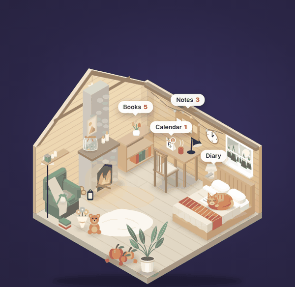</p>

---

## How it works

| Tap in the room | What opens |
| --- | --- |
| 🛏 The bed | **Diary**: a real little book you write, draw and put stickers and photos in |
| 📚 The bookshelf | **Books**: what you read, your progress, quotes and a yearly goal |
| 📌 The corkboard | **Notes**: quick things to remember, pinned on coloured paper |
| 📅 The desk calendar | **Calendar**: plans by day, week or month, with reminders |
| 🫙 The mood jar | **Moods**: one marble a day in the colour of how you felt |
| 🐱 Your pet | Say hi. It sleeps, plays and moves around the room through the day |

A short tour shows each of these the first time you open the app.

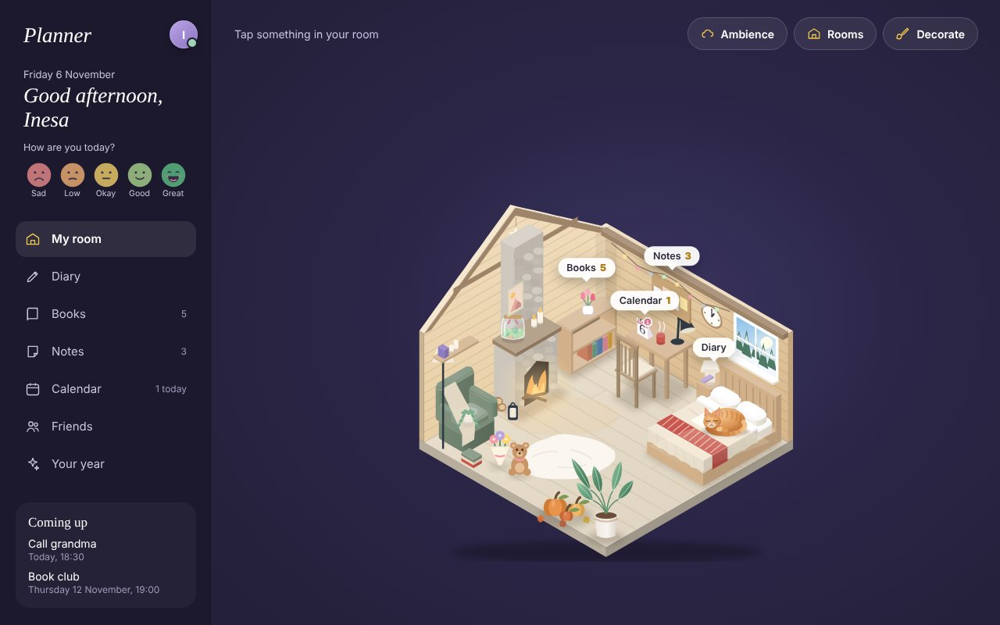

## What you can do

### ✏️ Write in a diary that feels like paper
Pages turn like a book. Type, draw with a pen, add stickers and photos, and move them between pages. Make a page a tracker, a to-do list, goals or a month plan. Keep your favourite pages in **Memories**, search everything you wrote, and save the whole diary as a PDF.

When you don't know what to write, the next empty page asks you **one small question a day**. Every 20 pages a colourful **chapter cover** begins a new part of your story.

<p>
  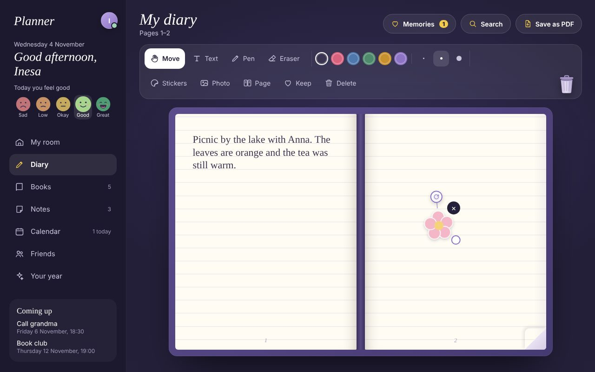
  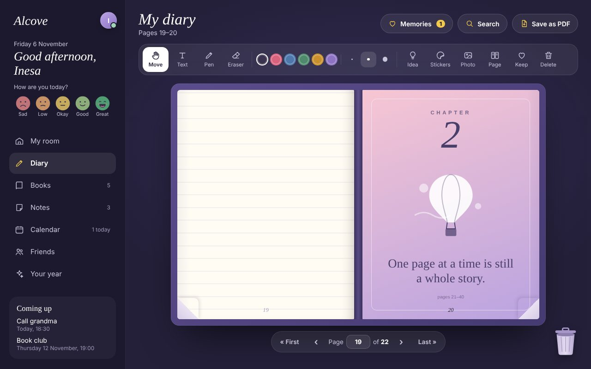
</p>

### 📚 Keep track of your books, notes and plans
Add the books you read and they appear on your shelf. Pin notes on a corkboard with fairy lights. Plan your days in the calendar and get a reminder on time.

<p>
  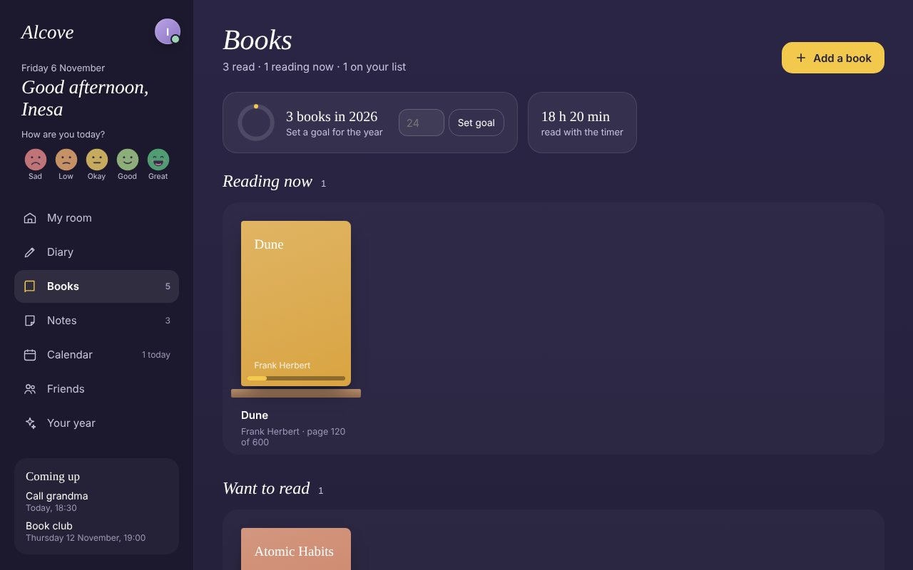
  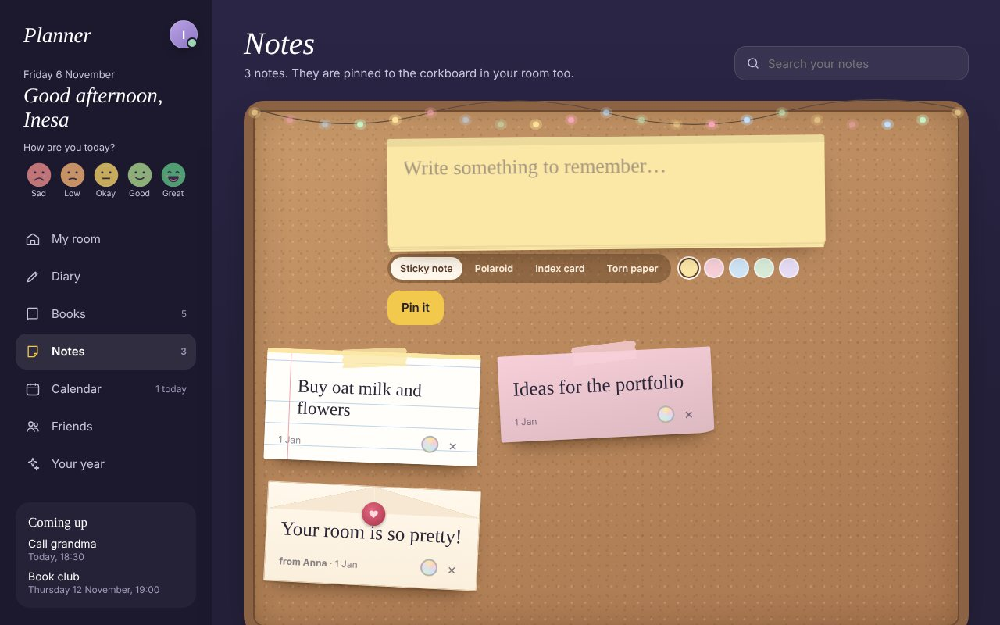
  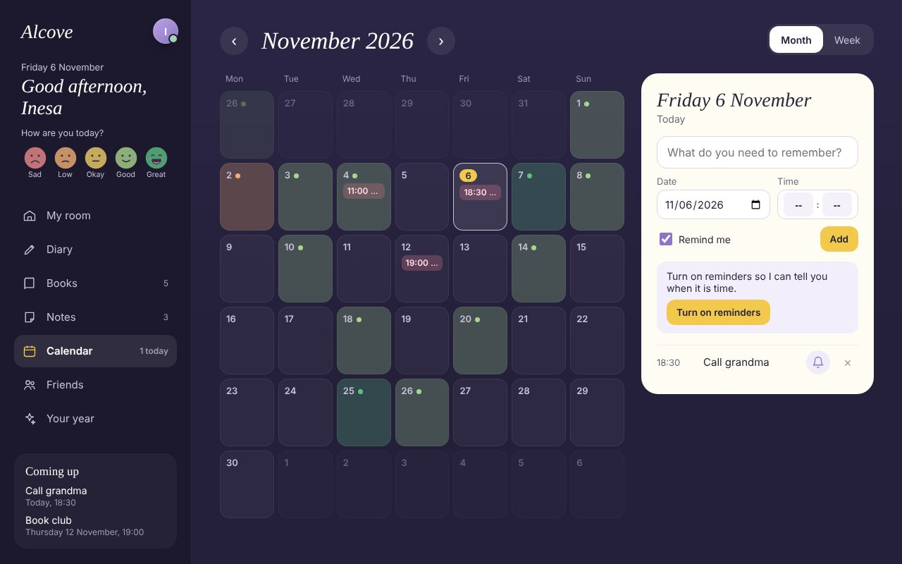
</p>

### 🛋 Make the room yours
Choose one of four rooms, each with its own shape: a **Nordic cabin**, a **night observatory**, a **seaside studio** or a **pastel room**. In **Decorate**, every piece has 3 styles: the bed, bookshelf, desk, chair, lamp, plant, flowers, clock and wall decoration. Change the colours, pick a cat or a dog and give it a name, or put your own photo in the window.

<p>
  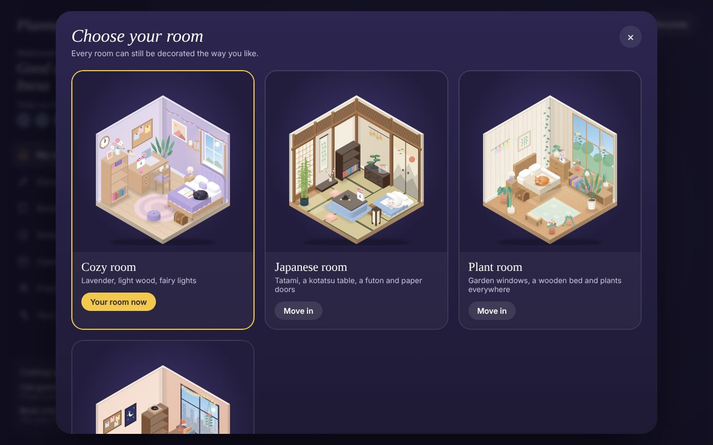
  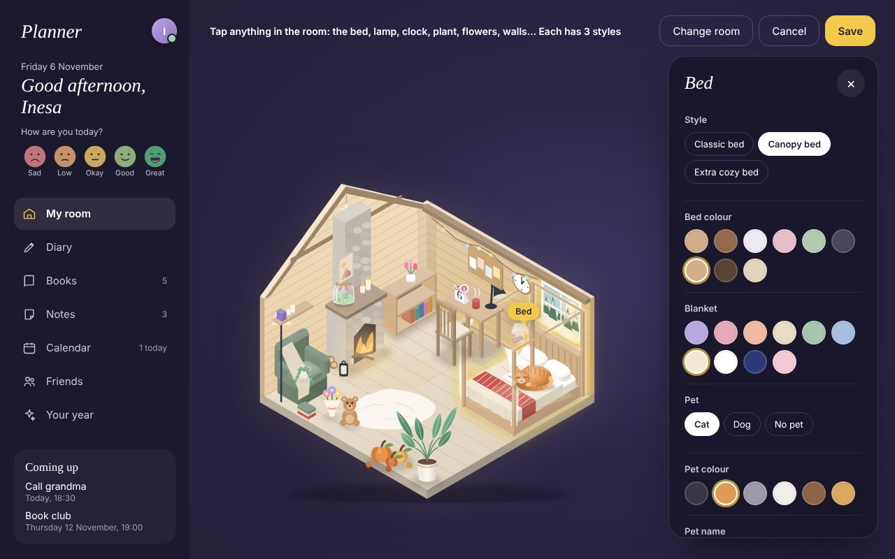
</p>

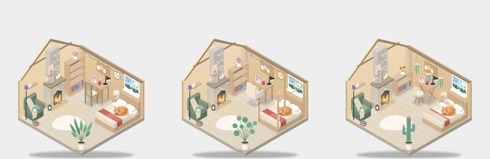

The room also follows real life: day and night in the window, the real weather where you live (rain, snow, sun), pumpkins in autumn, a little tree in December. You can turn on quiet sounds too: rain, a fireplace, birds or the sea.

### 💌 Visit friends
Share your friend code. You can visit each other's rooms, play with their pet, leave a note on their board, or leave a **gift**: flowers, a present, a teddy bear, a candle or a balloon that stands in their room.

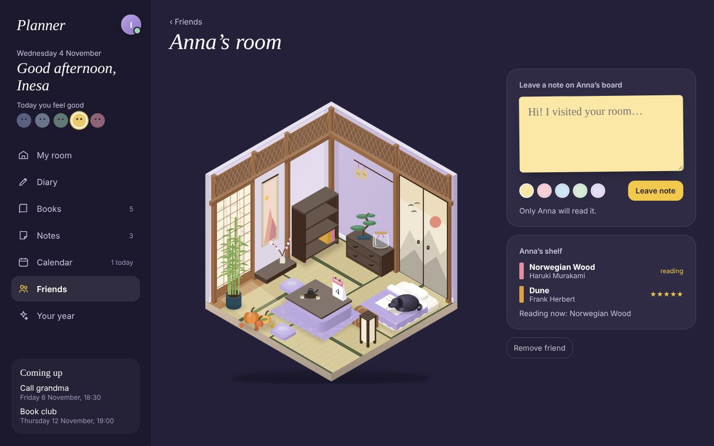

### ✨ See your year
Open a short story of your year, like Spotify Wrapped: the days you wrote, your favourite book, your mood, your plans. Share all the cards at once with friends.

<p>
  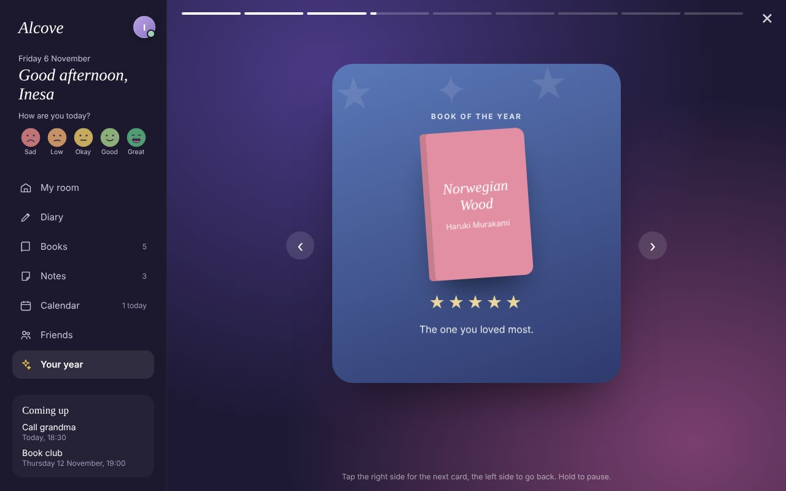
  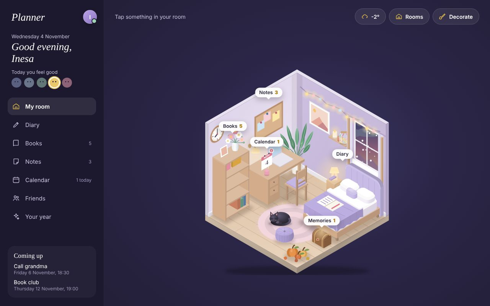
</p>

### 📱 On your phone too
Everything syncs between your phone and computer when you sign in. It also works offline.

<p align="center">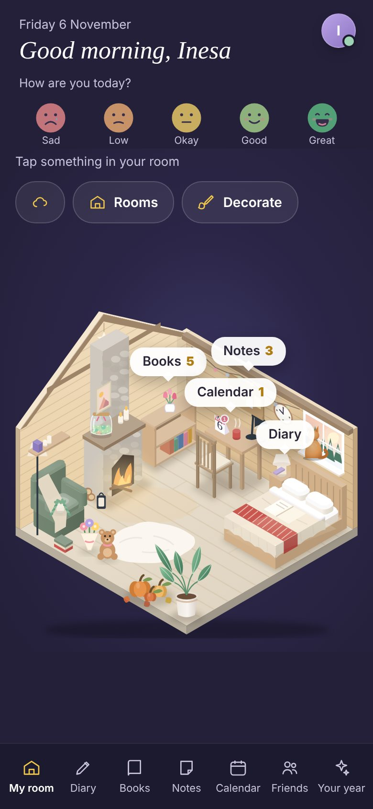</p>

---

## Case study (for product people)

### The problem

Plans, ideas, book lists and diary thoughts end up scattered across phone notes, a calendar app, a reading app and a paper notebook. After a few days it is hard to find anything, and none of these apps make you *want* to come back. Productivity apps feel like work, and diary apps feel empty.

### Who it is for

People who like journaling and cozy, personal things (the "study with me", lo-fi and bullet-journal crowd), who want one calm place for the day and are put off by dashboards full of lists.

### The idea

Turn the app into a **place** instead of a list. The home screen is a small isometric room. Instead of a menu, you tap the bed to open your diary, the shelf to see your books, the board for notes and the desk calendar for plans. The room changes with what you do, so it becomes a mirror of your days:

- the plant grows a leaf for every day in a row you write in the diary
- books you add appear on the shelf, the ones you are reading face out with their covers
- the window follows the real time of day and, if you want, the real weather where you are
- marbles fill the mood jar, one for every day of the month
- your cat or dog sleeps on the bed in the afternoon and sits on the window sill in the morning
- the room gets pumpkins in autumn, a little tree in December, heart balloons for Valentine's

### Product decisions

| Decision | Why |
| --- | --- |
| **The room is the navigation** | It makes the app feel like a place you visit, not a tool you use. It also teaches the app without a tutorial: every object has a label. |
| **Four rooms with their own shape** (a Nordic cabin with a pointed roof, a night observatory with a dome, a seaside studio with a deck, a pastel room with a raised platform) | The first rooms were the same box in different colours, and users said they all looked alike. Now every room has its own silhouette and furniture; the blanket, picture, window view and pet can still be changed. |
| **A reading tracker, not an e-reader** | Reading inside a planner competes with Kindle and has copyright problems. Tracking (progress, a reading timer, quotes, a yearly goal) fits the diary and the shelf. |
| **A paper diary, not a text editor** | Pages turn like a book, you can drag stickers, photos and text between pages, rotate them and draw. Deleted pages are crumpled into a recycle bin and can be brought back. |
| **Undo instead of "Are you sure?"** | Deleting is quick, and a toast with *Undo* fixes mistakes without slowing everyone down. |
| **Friends see your room, never your diary** | Social features make people come back, but a diary must feel private. A friend can visit your room and shelf and leave a note on your board, nothing else. |
| **Local first** | Everything is saved on the device first, so the app opens instantly and works offline. Sign-in syncs it between phone and computer. |
| **Removed the "quick capture" field** | It tried to guess where a sentence belongs. It was clever but confusing, and the room already makes each place obvious. |

### Measuring it

The app sends anonymous usage events (which pages are opened, that something was added — never what people write) to a table that only the owner's account can read, enforced by the database itself (row level security). The owner sees an `#admin` page with:

- **DAU / WAU / MAU** and **D1 / D7 retention**: do people come back?
- **Onboarding funnel**: how many finish each step
- **Engagement**: diary days, and how many books, plans and notes people add
- Which rooms people choose, which pages they use, how many diary days per person

These answer the main questions of the product: *does the room make people come back,* and *which part of the room do they actually use?*

### What I would do next

1. Push reminders when the app is closed (needs a small server)
2. Shared rooms: decorate a room together with a friend
3. Seasonal items you can collect and keep
4. AI help: "what did I write about Anna this year?" across the diary

---

## Technology

Plain HTML, CSS and JavaScript modules, no build step. The room is drawn as SVG on an isometric grid in code (no images). Data lives in `localStorage` and IndexedDB, and syncs through **Supabase** (auth, Postgres, row level security).

### Project structure

```
index.html              menu and page frame
css/                    styles, page styles, the light look
js/app.js               menu, greeting, mood picker, switching pages
js/room.js              draws every room, its furniture, pets, weather and seasons
js/store.js             notes, books, calendar, moods and room settings
js/db.js                diary pages and pictures (IndexedDB)
js/sync.js              sign-in and sync with Supabase
js/friends.js           friend codes, friends' rooms, notes for friends
js/weather.js           real weather from Open-Meteo
js/sounds.js            room sounds made with Web Audio
js/analytics.js         anonymous usage events
js/onboarding.js        the three welcome steps
js/tour.js              the guided tour of the room
js/chapters.js          chapter covers and the daily questions
js/templates.js         diary page layouts: tracker, to-do, goals, month
js/views/*.js           the pages: room, diary, books, notes, calendar, friends, your year, admin
sw.js                   offline support
supabase/*.sql          database tables and access rules
```

---

### 👉 [Open Planner](https://inesa07.github.io/Planner/)

Nothing to install: open the link in any browser on your computer or phone.
